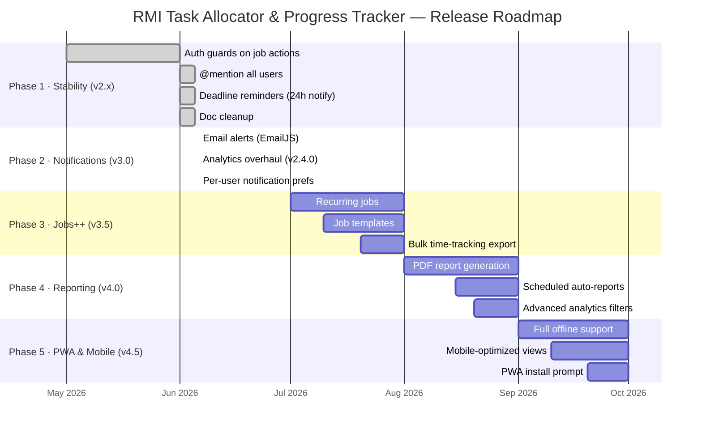
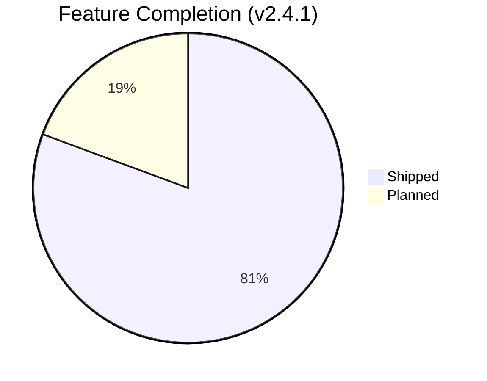

# RMI Task Allocator & Progress Tracker

Job/task management web app for Roof Metal Industries. Managers assign jobs to staff; staff track status, deadlines, completion.

**Stack:** Firebase (Auth + Firestore + Storage) · Cloudflare Pages · No build step, no framework, no npm.

---

## Files

| File | Role |
|------|------|
| `index.html` | Markup shell — all views, modals, login |
| `styles.css` | All styling — Apple-style dark theme + light mode via CSS vars |
| `main.js` | App bootstrap + remaining logic (auth, notifications, render, analytics, calendar, dashboard) — ES module entry (`type="module"`) |
| `firebase.js` | Firebase SDK re-exports + config |
| `state.js` | Shared state (live bindings) + setters + constants |
| `helpers.js` | Pure utilities — formatting, time math, escaping |
| `email.js` | EmailJS alert helpers |
| `modals.js` | Confirm/Complete/Extension/Reassign dialogs + tag inputs |
| `jobs.js` | Job CRUD, lifecycle actions, comments, extension review |
| `admin.js` | Broadcasts + user management |
| `manifest.webmanifest` | PWA manifest (installable app) |
| `sw.js` | Service worker — network-first cache |

**Module graph:** `main.js` is the entry; it imports the leaf modules
(`firebase`, `state`, `helpers`, `email`) and the domain modules
(`modals`, `jobs`, `admin`). Domain modules import shared functions back
from `main.js` — these cycles are runtime-safe because every cross-module
call happens inside a function body (after all modules finish loading),
never at module-evaluation time. Functions assigned to `window.*` are
global and called across modules without imports.
| `firestore.rules` | Firestore security rules — paste into Firebase Console |

---

## Roles

| Role | Scope |
|------|-------|
| `employee` | Own jobs only |
| `team_leader` | Own team only (always scoped, `viewAll` does not override) |
| `supervisor` | Assign + all jobs |
| `manager` | Full access |
| `managing_director` | Read-only oversight — sees Dashboard, Analytics, Teams, Account (own + read-only user directory). Views everything, changes nothing. Hidden from all staff team/board/assign/calendar lists. |
| `executive_director` | Identical to `managing_director` (different title/badge only). |

---

## Run locally

Do **not** open via `file://` — ES modules + Firebase break on that protocol.

```
python -m http.server 8000
```

Then open `http://localhost:8000`. `localhost` is auto-authorized in Firebase Auth.

---

## Deploy

Push to Cloudflare Pages (no build step — static files served directly).

**On every deploy:** bump `CACHE` in `sw.js` (e.g. `rmi-v1.7.3`) or users get stale cache.

---

## Firebase setup

1. **Firestore rules** — paste `firestore.rules` into Firebase Console → Firestore → Rules → Publish.
2. **Auth** — enable Email/Password provider.
3. **Authorized domains** — add your `*.pages.dev` URL (and custom domain if any) in Firebase Console → Authentication → Settings → Authorized domains.

### First-time user activation

Each user activates once via the in-app **Activate account** flow (name + temp password + email + new password). Manager activates first (default temp password: `manager123`).

---

## Data model

Collections: `jobs`, `users`, `events`, `notifications`, `extensions`, `broadcasts`, `loginlogs`, `usersByAuth`, `jobsArchive`, `config`

`config/email` — org-wide Email Control settings (manager-writable, everyone reads). Cascading gate: `master → per-event .on → per-recipient flag`.

Job statuses: `pending → ongoing → paused → completed`

---

## Roadmap



## Feature completion



| Status | Features |
|--------|----------|
| ✅ Shipped | Job CRUD, Roles & auth, Firebase auth, Analytics (role-specific layouts), Calendar, Board, Extensions, Broadcasts, In-app notifications, Email alerts (EmailJS), Email Control panel (manager, org-wide cascading switches), Attachments, Comments, @mentions (all users), Deadline reminders, Dark/light mode, Team leader role, Advanced search, CSV export, Activity log, PWA/SW + manifest, Auth guards, Type-filtered analytics, 6 new analytics charts, App rename, Per-user notification prefs, ES-module architecture (8 files) |
| 🔲 Planned | Recurring jobs, Job templates, Time-tracking export, PDF reports, Offline + mobile PWA, Advanced analytics filters |

---

## Troubleshooting

| Problem | Fix |
|---------|-----|
| Blank page on load | Open DevTools → Console; likely `file://` protocol — use local server |
| Auth domain error | Add Pages URL to Firebase Authorized domains |
| Firestore permission denied | Publish `firestore.rules`; user must activate so `usersByAuth` mapping exists |
| Stale UI after deploy | Bump `CACHE` string in `sw.js` before deploying |
