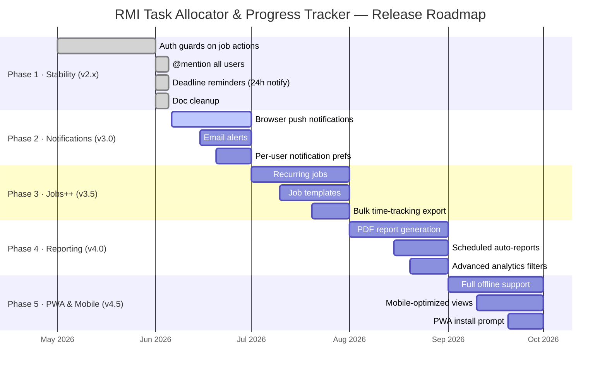
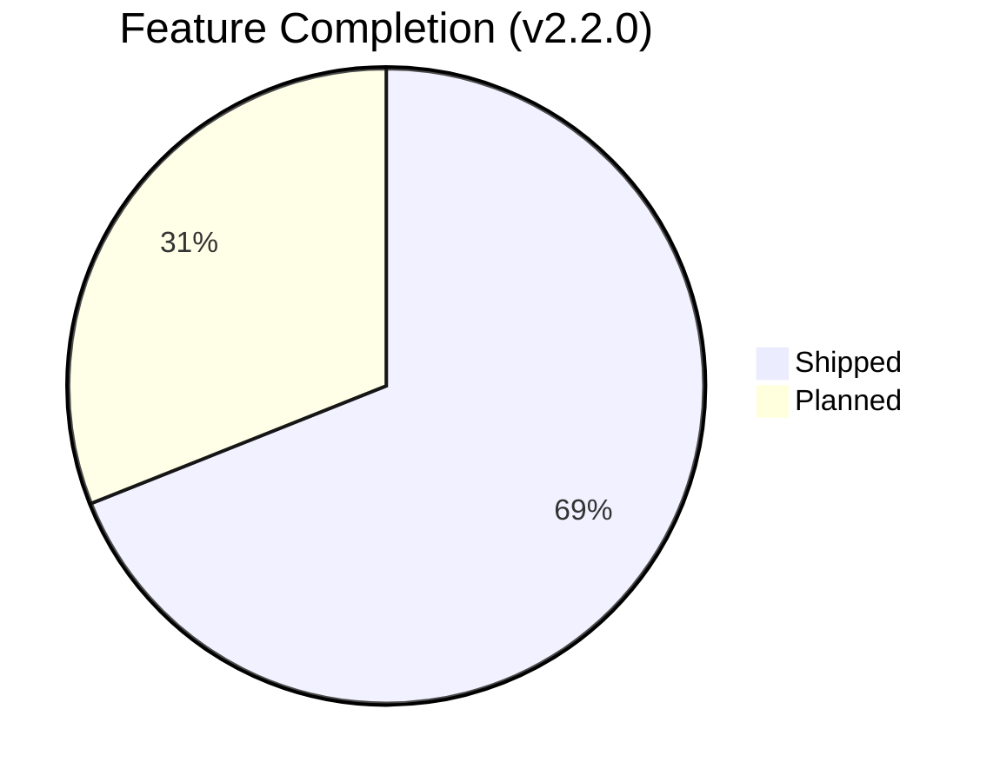

# RMI Task Allocator & Progress Tracker

Job/task management web app for Roof Metal Industries. Managers assign jobs to staff; staff track status, deadlines, completion.

**Stack:** Firebase (Auth + Firestore + Storage) · Cloudflare Pages · No build step, no framework, no npm.

---

## Files

| File | Role |
|------|------|
| `index.html` | Markup shell — all views, modals, login |
| `styles.css` | All styling — Apple-style dark theme + light mode via CSS vars |
| `script.js` | All logic — ES module, Firebase via CDN |
| `sw.js` | Service worker — network-first cache |
| `firestore.rules` | Firestore security rules — paste into Firebase Console |

---

## Roles

| Role | Scope |
|------|-------|
| `employee` | Own jobs only |
| `team_leader` | Own team only (always scoped, `viewAll` does not override) |
| `supervisor` | Assign + all jobs |
| `manager` | Full access |

---

## Run locally

Do **not** open via `file://` — ES modules + Firebase break on that protocol.

```
python -m http.server 8000
```

Then open `http://localhost:8000`. `localhost` is auto-authorized in Firebase Auth.

---

## Deploy

Push to Cloudflare Pages (no build step — static files served directly).

**On every deploy:** bump `CACHE` in `sw.js` (e.g. `rmi-v1.7.3`) or users get stale cache.

---

## Firebase setup

1. **Firestore rules** — paste `firestore.rules` into Firebase Console → Firestore → Rules → Publish.
2. **Auth** — enable Email/Password provider.
3. **Authorized domains** — add your `*.pages.dev` URL (and custom domain if any) in Firebase Console → Authentication → Settings → Authorized domains.

### First-time user activation

Each user activates once via the in-app **Activate account** flow (name + temp password + email + new password). Manager activates first (default temp password: `manager123`).

---

## Data model

Collections: `jobs`, `users`, `events`, `notifications`, `extensions`, `broadcasts`, `loginlogs`, `usersByAuth`, `jobsArchive`

Job statuses: `pending → ongoing → paused → completed`

---

## Roadmap



## Feature completion



| Status | Features |
|--------|----------|
| ✅ Shipped | Job CRUD, Roles & auth, Firebase auth, Analytics, Calendar, Board, Extensions, Broadcasts, In-app notifications, Attachments, Comments, @mentions (all users), Deadline reminders, Dark/light mode, Team leader role, Advanced search, CSV export, Activity log, PWA/SW, Auth guards |
| 🔲 Planned | Browser push, Email alerts, Notification prefs, Recurring jobs, Job templates, Time-tracking export, PDF reports, Scheduled reports, Offline + mobile PWA |

---

## Troubleshooting

| Problem | Fix |
|---------|-----|
| Blank page on load | Open DevTools → Console; likely `file://` protocol — use local server |
| Auth domain error | Add Pages URL to Firebase Authorized domains |
| Firestore permission denied | Publish `firestore.rules`; user must activate so `usersByAuth` mapping exists |
| Stale UI after deploy | Bump `CACHE` string in `sw.js` before deploying |
