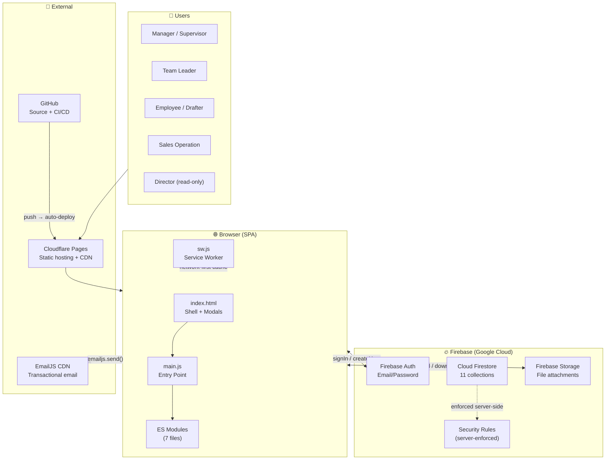
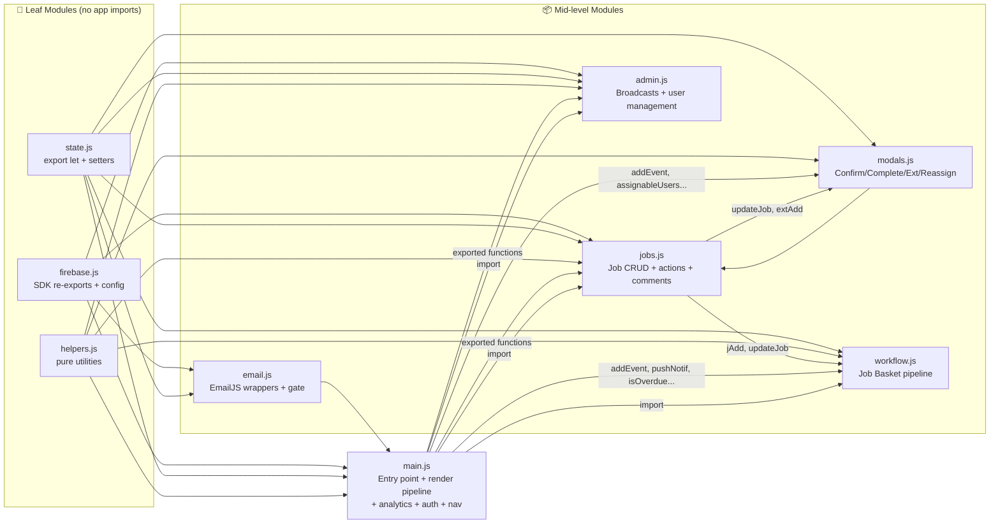
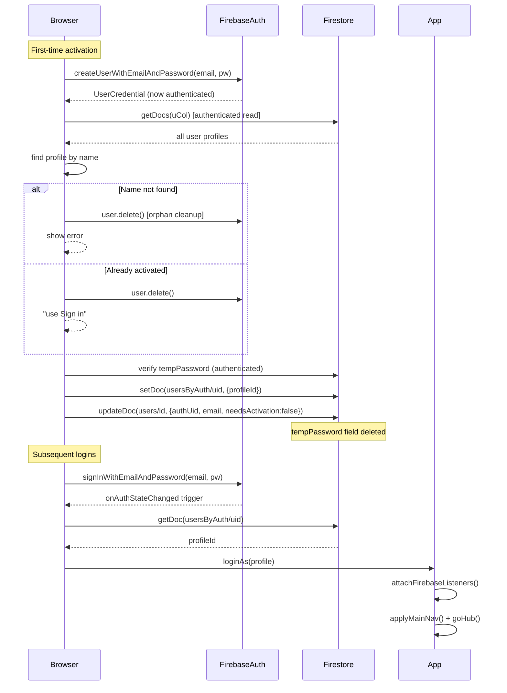
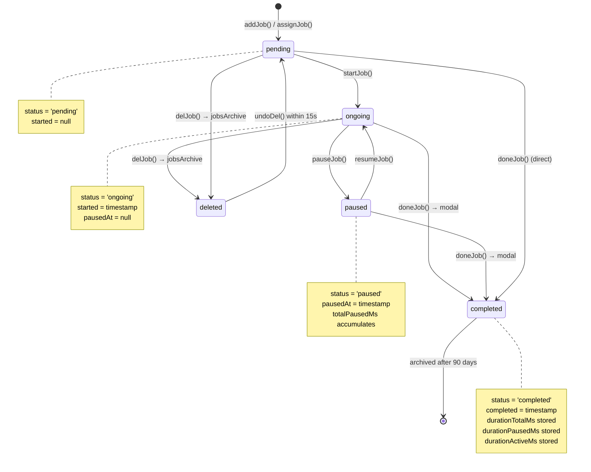
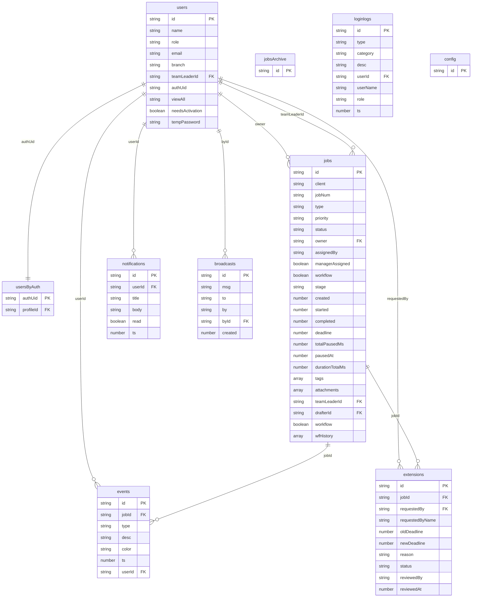
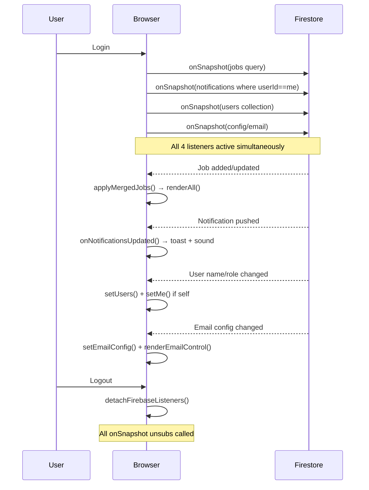
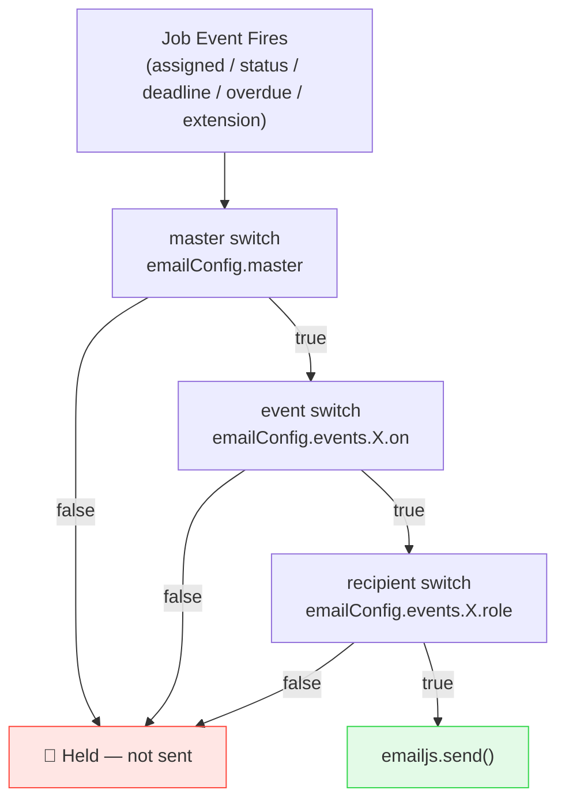
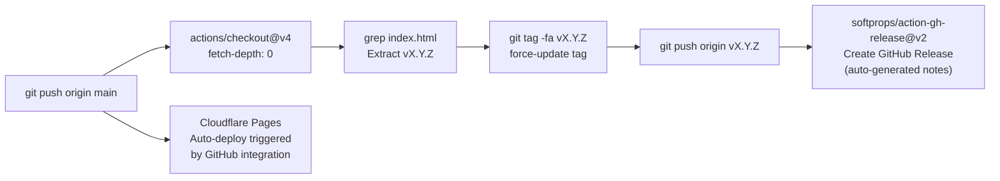
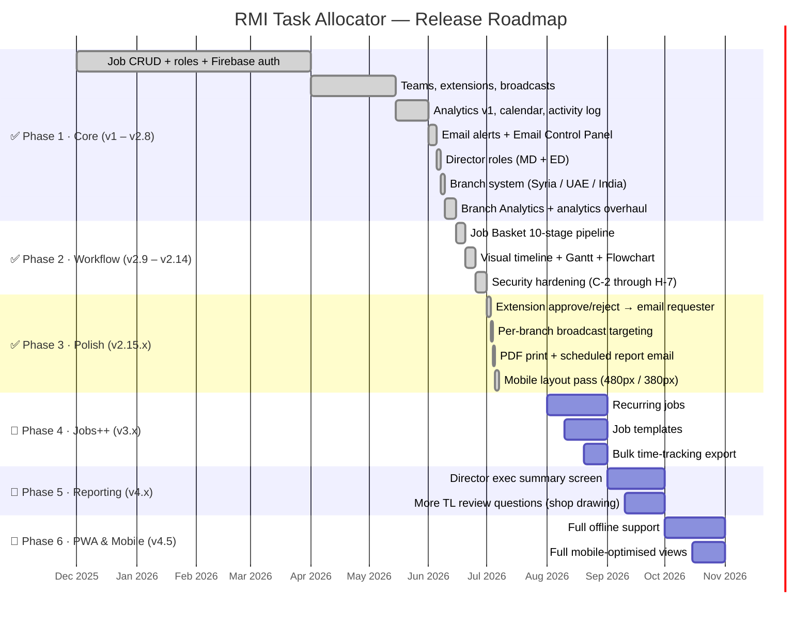

<div align="center">

# RMI Task Allocator & Progress Tracker

**Enterprise job-management platform for Roof Metal Industries — multi-branch, multi-role, real-time.**

[](https://github.com/abdullahtalsayed/RMI-Task-Allocator-Project/releases)
[](https://firebase.google.com)
[](https://pages.cloudflare.com)
[](https://developer.mozilla.org/en-US/docs/Web/JavaScript/Guide/Modules)
[](https://web.dev/progressive-web-apps/)
[](#)

</div>

---

## Table of Contents

1. [Project Overview](#1-project-overview)
2. [Executive Summary](#2-executive-summary)
3. [Feature Matrix](#3-feature-matrix)
4. [Architecture Overview](#4-architecture-overview)
   - [System Context](#41-system-context)
   - [Module Dependency Graph](#42-module-dependency-graph)
   - [Authentication Flow](#43-authentication-flow)
   - [Job Lifecycle State Machine](#44-job-lifecycle-state-machine)
   - [Workflow Pipeline (Job Basket)](#45-workflow-pipeline-job-basket)
   - [Firestore Data Model (ERD)](#46-firestore-data-model-erd)
   - [Real-Time Listener Architecture](#47-real-time-listener-architecture)
   - [Email System Cascade](#48-email-system-cascade)
5. [Role System](#5-role-system)
6. [Branch System](#6-branch-system)
7. [Data Model Reference](#7-data-model-reference)
8. [Module Reference](#8-module-reference)
9. [Email System](#9-email-system)
10. [Analytics System](#10-analytics-system)
11. [Job Basket Workflow](#11-job-basket-workflow)
12. [Notification System](#12-notification-system)
13. [Security Model](#13-security-model)
14. [PWA & Service Worker](#14-pwa--service-worker)
15. [CI/CD Pipeline](#15-cicd-pipeline)
16. [Getting Started](#16-getting-started)
17. [Firebase Setup](#17-firebase-setup)
18. [Deployment](#18-deployment)
19. [Local Development](#19-local-development)
20. [Configuration Reference](#20-configuration-reference)
21. [Troubleshooting](#21-troubleshooting)
22. [Roadmap](#22-roadmap)

---

## 1. Project Overview

**RMI Task Allocator & Progress Tracker** is a production web application built for **Roof Metal Industries** — a multi-branch, multi-country metal roofing and cladding manufacturer operating across Syria, UAE, and India.

### Why It Exists

RMI's drafting and engineering teams operate across multiple time zones, produce shop drawings, job cards, and release documents on tight deadlines, and historically had no unified system to track job assignments, stage handoffs, or team workload. Jobs were tracked in spreadsheets; handoffs happened via WhatsApp; no one had a live view of what was overdue.

This platform replaces all of that with:

- A real-time job board visible to every role simultaneously
- A structured 10-stage workflow pipeline for shop drawings (the Job Basket)
- Automated deadline reminders and extension management
- Per-branch, per-person analytics with bottleneck detection
- A full audit trail of every action on every job

### Problems It Solves

| Problem | Solution |
|---------|----------|
| No live visibility into team workload | Real-time Firestore listeners push updates to all clients without refresh |
| Shop drawing handoffs happen informally | 10-stage Job Basket pipeline with gated checklists at every handoff |
| Managers don't know when jobs go overdue | Automatic 24h deadline warning emails + overdue alerts |
| New team members activate accounts insecurely | Zero pre-auth Firestore read — account activation creates Firebase Auth first |
| Analytics meaningless without branch context | Per-branch filters and side-by-side branch comparisons across all metrics |
| Email noise can't be controlled | Cascading 3-tier email control panel (master → event → recipient) stored in Firestore |

### Target Users

| Role | Description |
|------|-------------|
| Manager | Full system administration — user management, assignments, email control, broadcasting |
| Supervisor | Cross-team oversight, assignment, analytics |
| Team Leader | Leads a team of employees, manages the Job Basket pipeline for their team |
| Employee / Drafter | Executes assigned jobs, progresses workflow stages, requests extensions |
| Sales Operation | Creates shop drawing jobs and routes them into the basket |
| Managing / Executive Director | Read-only live dashboard across the entire organisation |

### Technical Goals

- **Zero build step** — plain ES modules loaded from CDN, deployed as static files
- **Firebase as the only backend** — no servers, no functions, no containers
- **Real-time by default** — all data delivered via `onSnapshot` listeners, not polling
- **Progressive Web App** — installable, offline-capable via service worker
- **Security enforced at the database layer** — Firestore rules are the true security gate, not client-side guards

---

## 2. Executive Summary

RMI Task Allocator is a **single-page application** (SPA) that manages the full lifecycle of technical drafting work across a manufacturing organisation. It consists of two parallel job systems:

**1. Manual Job System** — Managers and supervisors assign jobs directly to employees. Jobs move through `pending → ongoing → paused → completed`. Every status change, comment, reassignment, and edit is logged in real time.

**2. Job Basket Workflow** — Sales Operation submits shop drawing jobs that auto-route to the healthiest team leader (weighted by team workload). Jobs progress through 10 gated stages — each requiring a checklist before advancing, creating a mandatory quality control trail.

Both systems share the same notification, email, analytics, and audit infrastructure.

**Key selling points:**
- Live workload visualisation per employee (load colour-coding: green / yellow / red)
- Weighted auto-assignment: busier teams receive fewer new jobs automatically
- Mandatory gated checklists at every stage handoff — cannot skip
- 3-tier email gate: master kill-switch → per-event → per-recipient-role
- 20+ analytics widgets that are role-scoped and fully filterable
- Per-branch comparisons (Syria / UAE / India) across every metric
- Gantt chart, visual timeline, and flowchart per workflow job
- Full audit trail stored in Firestore `events` — every action, who, when
- PDF print and weekly CSV export with optional scheduled email delivery
- Installable PWA with network-first caching and offline fallback

---

## 3. Feature Matrix

### Core Job Management

| Feature | Description | Status | Notes |
|---------|-------------|--------|-------|
| Job CRUD | Create, edit, delete, restore jobs | ✅ Live | Soft delete with 15s undo |
| Manager-assigned jobs | Leads assign jobs to specific team members | ✅ Live | `managerAssigned` flag locks delete to manager only |
| Self-submitted jobs | Employees create their own jobs | ✅ Live | Owner defaults to current user |
| Job priorities | High / Medium / Low with visual indicators | ✅ Live | Colour-coded throughout |
| Job types | 15 predefined types + free-form tag system | ✅ Live | `JOB_TYPES` constant in `state.js` |
| Tags | Comma/Enter-separated tag chips on any job | ✅ Live | Stored as `string[]` on job doc |
| Deadline | Optional per-job deadline with banner warning | ✅ Live | 24h warning banner above nav |
| Deadline banner | Countdown strip for jobs due within 24h | ✅ Live | XSS-escaped, fires at page load |
| Pin jobs | Manager/owner can pin a job to the top | ✅ Live | `pinned: boolean` field |
| Job notes | Free-text notes field on create/edit | ✅ Live | |
| Manager note | Private note from assigning manager | ✅ Live | `managerNote` field, shown only to lead |
| Bulk actions | Select multiple jobs → bulk status / delete / reassign | ✅ Live | `selectedJobs: Set` in main.js |
| Job export | Export individual job as `.txt` file with full timeline | ✅ Live | `expTXT(id)` |
| CSV export | Export visible job list as `.csv` | ✅ Live | `exportWeeklyReport()` |
| File attachments | Upload files via Firebase Storage, shown inline | ✅ Live | Max 8MB per file |
| Restore (undo delete) | Restores from in-memory `lastDel` within 15s | ✅ Live | `undoDel()` |

### Workflow Pipeline (Job Basket)

| Feature | Description | Status | Notes |
|---------|-------------|--------|-------|
| 10-stage pipeline | `intake → drafting → tl_sample_review → detailing → tl_sd_review → client_wait → jobcard → tl_jobcard_review → completed → release` | ✅ Live | See §11 |
| Weighted auto-assignment | New jobs route to the TL with the lowest workload score | ✅ Live | Overdue jobs penalised double in scoring |
| Gated checklists | Every stage advance requires answering Yes/No questions | ✅ Live | Answers stored in `wfHistory` |
| Overload detection | TL warned if assigned drafter has ≥3 active tasks | ✅ Live | Offers reassign to freest member |
| Visual timeline | Interactive horizontal timeline per job | ✅ Live | `wfToggleTimeline()` |
| Per-job Gantt | Horizontal time-bar chart of stage durations | ✅ Live | `wfToggleJobGantt()` |
| Per-job flowchart | Horizontal flowchart with approve/reject arrows | ✅ Live | `wfToggleJobFlow()` |
| Full Gantt chart | Overview Gantt of all workflow jobs in a tab | ✅ Live | `wfToggleGantt()` |
| Release continuation | Post-completion reopen for release preparation | ✅ Live | `releaseEligible` flag |
| Workflow analytics | Stage duration averages, bottleneck detection, throughput per drafter | ✅ Live | `wfAnalyticsSection()` |

### Teams & People

| Feature | Description | Status | Notes |
|---------|-------------|--------|-------|
| Team Leader → Employee assignment | TL manages their own team members | ✅ Live | `teamLeaderId` field on users |
| Employee grid | Visual card grid showing each assignable employee with load indicator | ✅ Live | Load preview on hover |
| User directory | Grouped by role with branch badges | ✅ Live | `renderUList()` |
| Org chart | Teams overview showing TL → members hierarchy | ✅ Live | `teams-overview` section |
| Branch tagging | Every user tagged to Syria / UAE / India | ✅ Live | `BRANCHES` constant |
| Director roles | Managing Director + Executive Director — read-only, invisible to staff | ✅ Live | `DIRECTOR_ROLES` constant |
| Real-time user sync | Name/role changes propagate instantly to all clients | ✅ Live | `uCol` `onSnapshot` listener |

### Notifications & Messaging

| Feature | Description | Status | Notes |
|---------|-------------|--------|-------|
| In-app notifications | Real-time push via Firestore `onSnapshot` | ✅ Live | Bell icon with unread count |
| Toast notifications | Non-blocking banner alerts for urgent events | ✅ Live | `NOTIF_TOAST_MAX=12` |
| Desktop notifications | Browser-native push (requires permission) | ✅ Live | Opt-in via preferences |
| Notification sound | Chime on new notification | ✅ Live | Opt-in via preferences |
| Broadcasts | Manager/TL compose + send to audience | ✅ Live | |
| Branch targeting | Manager broadcasts to specific branch | ✅ Live | `branch:RMI - Syria` prefix |
| Role targeting | Broadcasts to employees / supervisors / team | ✅ Live | |
| Unread badge | Badge count on messages sidebar item | ✅ Live | `updateMsgBadge()` |

### Email System

| Feature | Description | Status | Notes |
|---------|-------------|--------|-------|
| Job assigned email | Email sent to new owner on assignment | ✅ Live | Event: `assigned` |
| Status change email | Email on start / pause / resume / complete | ✅ Live | Event: `status` |
| Deadline warning email | Fires within 24h of deadline, deduplicated per job/day | ✅ Live | Event: `deadline` |
| Overdue email | Fires once per job when deadline passes, deduplicated | ✅ Live | Event: `overdue` |
| Extension request email | Email to oversight on extension request | ✅ Live | Event: `extension` |
| Extension approved email | Email to requester when approved | ✅ Live | Fired from `approveExt()` |
| Extension rejected email | Email to requester when rejected | ✅ Live | Fired from `rejectExt()` |
| Email Control Panel | Master + per-event + per-recipient cascading switches | ✅ Live | Firestore-backed, shared across managers |
| Scheduled report email | Weekly summary auto-emailed to all managers + supervisors | ✅ Live | Toggle in Email Control panel |

### Analytics

| Feature | Description | Status | Notes |
|---------|-------------|--------|-------|
| Overview KPIs | Pending / Ongoing / Paused / Completed / Overdue / Done Today / Done This Week / Avg Completion | ✅ Live | All roles |
| Status donut chart | Visual breakdown of job statuses | ✅ Live | |
| Completion trend | Monthly completions line chart | ✅ Live | |
| Throughput | Completed jobs per employee bar chart | ✅ Live | Manager+ |
| Team health | Per-member overdue / active / completion% | ✅ Live | Manager+ |
| Overdue rate trend | Line chart of overdue rate over time buckets | ✅ Live | |
| Branch analytics | Side-by-side branch comparisons | ✅ Live | Syria / UAE / India |
| Performance leaderboard | Cards per employee showing stats | ✅ Live | Manager only |
| Job age | Active jobs bucketed by how long open | ✅ Live | |
| Priority vs urgency | Overdue % by priority | ✅ Live | |
| Extension rate | % jobs with extension requests | ✅ Live | |
| Peak workload | Bar chart of created vs completed by day of week | ✅ Live | |
| Turnaround by type | Avg completion time per job type | ✅ Live | |
| Most reassigned jobs | Bar chart of top reassigned jobs | ✅ Live | |
| Cross-team type breakdown | Job type distribution by team | ✅ Live | Supervisor+ |
| Workflow analytics | Stage durations, bottleneck, sample rejections, drafter throughput | ✅ Live | TL+ |
| PDF print | Print-ready report window with all analytics | ✅ Live | `printAnalytics()` |

### Infrastructure

| Feature | Description | Status | Notes |
|---------|-------------|--------|-------|
| PWA | Installable, Add to Home Screen | ✅ Live | `manifest.webmanifest` |
| Service worker | Network-first with offline fallback | ✅ Live | `sw.js` |
| Dark / Light mode | System-preference-aware, persisted in localStorage | ✅ Live | |
| Activity log | Full audit trail of every action | ✅ Live | `loginlogs` collection |
| SRI hashes | CDN scripts protected with `integrity=` attributes | ✅ Live | |
| Security headers | HSTS, X-Frame-Options, CSP, Referrer-Policy via `firebase.json` | ✅ Live | |
| CI/CD versioning | GitHub Actions auto-creates release tag on every push | ✅ Live | `.github/workflows/version.yml` |

---

## 4. Architecture Overview

### 4.1 System Context



### 4.2 Module Dependency Graph



> **Circular import safety:** `jobs`, `admin`, and `modals` import functions back from `main.js`. All cross-module calls occur inside function bodies — never at module evaluation time. ES module live bindings ensure state propagates automatically.

### 4.3 Authentication Flow



### 4.4 Job Lifecycle State Machine



### 4.5 Workflow Pipeline (Job Basket)

```mermaid
flowchart LR
    SO["📤 Sales Op\nSubmit Job"]
    I["intake\nTL Intake\n👤 TL"]
    DR["drafting\nLayout & Sample\n👤 Drafter"]
    SR["tl_sample_review\nSample Review\n👤 TL"]
    DT["detailing\nSD Detailing\n👤 Drafter"]
    SDR["tl_sd_review\nSD Review\n👤 TL"]
    CW["client_wait\nClient Approval\n👤 TL"]
    JC["jobcard\nJob Card Prep\n👤 Drafter"]
    JCR["tl_jobcard_review\nCard Review\n👤 TL"]
    DONE["completed\n✅ Done"]
    REL["release\nRelease Prep\n👤 Drafter"]

    SO -->|"weighted auto-assign\nto freest TL"| I
    I -->|"Take & Assign\n+checklist"| DR
    DR -->|"Submit Sample\n+checklist"| SR
    SR -->|"✓ Approve"| DT
    SR -->|"✗ Reject"| DR
    DT -->|"Submit SD"| SDR
    SDR -->|"✓ Approve\n→ Client"| CW
    CW -->|"Client Approved\n+overload check"| JC
    JC -->|"Submit Cards\n+QC5 checklist"| JCR
    JCR -->|"✓ Final QC\nClose Job"| DONE
    DONE -->|"Reopen for\nRelease"| REL
    REL -->|"Submit Releases\n+QC5 checklist"| DONE

    style SO fill:#0a84ff22,stroke:#0a84ff
    style DONE fill:#32d74b22,stroke:#32d74b
    style SR fill:#ffd60a22,stroke:#ffd60a
    style JCR fill:#ffd60a22,stroke:#ffd60a
    style SDR fill:#ffd60a22,stroke:#ffd60a
```



**QC5 Checklist** (required at `jobcard` submit, `tl_jobcard_review` close, and `release` submit):
1. Did you check the color?
2. Did you check the material specs?
3. Did you check quantity availability in the quotation?
4. Did you check for any samples?
5. Did you check the panel thickness specs / sketches?

### 4.6 Firestore Data Model (ERD)



### 4.7 Real-Time Listener Architecture



**Team Leader additional listener:**

Team Leaders with non-`viewAll` scope get a second jobs listener: `where('teamLeaderId','==',me.id)`. This ensures workflow jobs currently assigned to drafters (whose `owner` points to the drafter, not TL) still appear in the TL's Job Basket. The two snapshots are merged client-side via `applyMergedJobs()`.

### 4.8 Email System Cascade



**Additional gates:**
- `USE_FIREBASE` must be `true` (local mode = no emails)
- `emailjs` global must be defined (CDN loaded)
- `toEmail` must be non-empty
- For emails to the current user: `userSettings[prefKey]` must not be `false`

---

## 5. Role System

Eight distinct roles with strictly enforced scopes. Access validated in both client JS and Firestore security rules.

| Role | Badge | Add Jobs | See All Jobs | Manage Team | Admin Tools | Job Basket |
|------|-------|:--------:|:------------:|:-----------:|:-----------:|:----------:|
| `employee` | `👤` | ✅ own | ❌ own only | — | — | ⚡ My Tasks |
| `drafter` | `👤` | ✅ own | ❌ own only | — | — | ⚡ My Tasks |
| `sales_operation` | `📤` | ❌ | ❌ own basket | — | — | 📤 Submit / Active / Done |
| `team_leader` | `🧭` | ✅ | ✅ team only | Own team | Assign within team | ⚡ Queue / Team / Done |
| `supervisor` | `🔰` | ✅ | ✅ all | Cross-team | Assign anyone | 🧺 Overview |
| `manager` | `👔` | ✅ | ✅ all | All | Full admin | 🧺 Overview |
| `managing_director` | — | ❌ | ✅ all | Read-only | Read-only | 🧺 Overview |
| `executive_director` | — | ❌ | ✅ all | Read-only | Read-only | 🧺 Overview |

**Director constraints:**
- Cannot add, edit, delete, assign, start, pause, resume, or complete any job
- Invisible to all staff — never appear in assignment dropdowns, team boards, calendar filters, or analytics people lists
- Can view timeline + add comments on any job
- Land on Dashboard as their default view

**Team Leader scope lock:**
- `visibleJobs()` always scopes to `myTeamIds()` regardless of `viewAll` setting
- `assignableUsers()` returns only users where `teamLeaderId === me.id`
- Firestore rule `affectedKeys().hasOnly([...])` restricts which fields TL can write on jobs

**`viewAll` override:**
- Non-lead roles (employee, drafter) can be granted `viewAll: 'yes'` by a manager
- Allows them to see all jobs in analytics and job list
- Does NOT grant any write permissions

---

## 6. Branch System

Each user account carries a `branch` field: `"RMI - Syria"`, `"RMI - UAE"`, or `"RMI - India"`.

**How it works:**
- Set by manager during user create/edit
- Displayed as a coloured pill badge everywhere users are shown
- Jobs inherit their branch from `jobs[n].owner → users[owner].branch` — no per-job branch field
- Branch filter in Analytics lets any manager/supervisor/director filter all 20+ widgets to a single branch
- Branch Analytics section renders side-by-side comparisons: active / completed / overdue / on-time rate / avg turnaround per branch
- Broadcasts can be targeted to a specific branch — only users with `user.branch === br` receive them

**Badge colours:**

| Branch | CSS variable | Colour |
|--------|-------------|--------|
| RMI - Syria | `--bdg-sy` | Amber |
| RMI - UAE | `--bdg-uae` | Teal |
| RMI - India | `--bdg-in` | Coral |

---

## 7. Data Model Reference

### `users` collection

```js
{
  id: string,               // document ID (e.g. "manager", UUID for others)
  name: string,             // display name
  role: string,             // employee | drafter | sales_operation | team_leader |
                            //   supervisor | manager | managing_director | executive_director
  email: string,            // used for Firebase Auth + email alerts
  branch: string,           // "RMI - Syria" | "RMI - UAE" | "RMI - India"
  teamLeaderId: string,     // ID of the TL this user reports to (employees/drafters only)
  authUid: string,          // Firebase Auth UID (set during activation)
  viewAll: 'yes' | null,    // override: see all jobs regardless of role
  needsActivation: boolean, // true until account is activated by user
  // removed after activation:
  tempPassword: string,     // manager-set one-time temp password (deleted on activate)
}
```

### `usersByAuth` collection

```js
{
  // document ID = Firebase Auth UID
  profileId: string         // → users/{id}
}
```

### `jobs` collection

```js
{
  id: string,               // auto-generated
  client: string,
  jobNum: string,
  type: string,             // one of JOB_TYPES
  priority: 'High' | 'Medium' | 'Low',
  status: 'pending' | 'ongoing' | 'paused' | 'completed',
  owner: string,            // current assignee user ID
  assignedBy: string,       // name of assigning manager
  managerAssigned: boolean, // true → only manager can delete
  created: number,          // ms timestamp
  started: number | null,
  completed: number | null,
  deadline: number | null,
  notes: string,
  completionNote: string | null,
  managerNote: string | null,
  tags: string[],
  attachments: string[],    // Firebase Storage download URLs
  pinned: boolean,
  totalPausedMs: number,    // accumulated pause time
  pausedAt: number | null,  // current pause start (if paused)
  durationTotalMs: number,  // set on completion
  durationPausedMs: number,
  durationActiveMs: number,
  reassignedBy: string | null,
  reassignedAt: number | null,

  // workflow jobs only (workflow: true)
  workflow: true,
  stage: string,            // one of WF_STAGES keys
  teamLeaderId: string,
  drafterId: string | null,
  wfCreatedBy: string,
  wfCreatedByName: string,
  wfHistory: WfHistoryEntry[],
  releaseEligible: boolean,
  rejectedSample: boolean,
  rejectNote: string | null,
  source: 'sales',
  projectName: string,
}
```

### `WfHistoryEntry` (element of `wfHistory`)

```js
{
  stage: string,            // from-stage key
  to: string,               // to-stage key
  action: string,           // 'submitted' | 'assigned' | 'sample_submitted' | 'sample_approved' |
                            //   'sample_rejected' | 'sd_submitted' | 'sd_to_client' |
                            //   'jobcard_assigned' | 'jobcard_submitted' | 'completed' |
                            //   'release_assigned' | 'release_completed' | 'advance'
  by: string,               // actor name
  byId: string,             // actor user ID
  at: number,               // ms timestamp
  checklist: object | null, // { key: boolean } answers to gate questions
  note: string | null,      // optional free-text note (shown on reject)
}
```

### `events` collection

```js
{
  id: string,
  jobId: string,
  type: string,             // see ACTIVITY_TYPE_LABELS in state.js
  desc: string,
  color: string,            // 'green' | 'red' | 'blue' | 'yellow' | 'orange' | 'purple'
  ts: number,
  userId: string | null,
}
```

### `notifications` collection

```js
{
  id: string,
  userId: string,           // recipient
  title: string,
  body: string,
  read: boolean,
  ts: number,
}
```

### `extensions` collection

```js
{
  id: string,
  jobId: string,
  jobNum: string,
  client: string,
  requestedBy: string,      // user ID
  requestedByName: string,
  oldDeadline: number | null,
  newDeadline: number,
  reason: string,
  status: 'pending' | 'approved' | 'rejected',
  created: number,
  reviewedBy: string | null,
  reviewedAt: number | null,
}
```

### `broadcasts` collection

```js
{
  id: string,
  msg: string,
  to: string,               // 'all' | 'employees' | 'supervisors' |
                            //   'team:{leaderId}' | 'branch:{branchName}'
  by: string,               // sender name
  byId: string,
  created: number,
}
```

### `config/email` document

```js
{
  master: boolean,          // global kill-switch
  events: {
    assigned:   { on: boolean, owner: boolean, teamLeader: boolean, supervisor: boolean, manager: boolean },
    status:     { ... },
    deadline:   { ... },
    overdue:    { ... },
    extension:  { on: boolean, teamLeader: boolean, supervisor: boolean, manager: boolean },
  }
}
```

---

## 8. Module Reference

| File | Approx Lines | Responsibility |
|------|:------------:|----------------|
| `index.html` | ~950 | SPA shell: all views, modals, login screen, sidebar, header |
| `styles.css` | ~1,850 | Complete design system: CSS variables, dark/light mode, all components, responsive breakpoints (600px / 640px / 700px / 768px / 900px / 1000px + 480px mobile pass) |
| `main.js` | ~4,500 | Entry point: Firebase init, auth, real-time listeners, render pipeline, analytics, dashboard, calendar, nav, notifications, email control, scheduled jobs |
| `firebase.js` | 18 | Firebase 10.12.0 SDK re-exports via CDN. `CFG`, `USE_FIREBASE`, `USE_AUTH` |
| `state.js` | 65 | All shared mutable state as `export let` + setter functions. Constants: `JOB_TYPES`, `BRANCHES`, `EMAIL_EVENTS`, `FB_LIMITS`, `ARCHIVE_AFTER_MS`, `DEFAULT_SETTINGS` |
| `helpers.js` | 49 | Pure, stateless utilities: `toMillis`, `fmt`, `fmtShort`, `tdiff`, `escapeHtml`, `uid`, `timeAgo`, `getJobDurationBreakdown`, `formatJobDurationHtml`, `jobPauseDefaults` |
| `email.js` | 72 | EmailJS wrappers. Cascading gate: `gMaster → gEvent → gRecip`. Named senders: `emailJobOwner`, `emailManagersAndSupervisors`, `emailEventOwner`, `emailEventOversight`, etc. |
| `modals.js` | 114 | Confirm modal, Complete modal (with duration calc), Extension request modal, Reassign modal, tag-chip inputs |
| `jobs.js` | 295 | Job CRUD (`jAdd/jUpdate/jDelete/jRestore`), user CRUD (`uAdd/uUpdate/uDelete`), job actions (`startJob/pauseJob/resumeJob/doneJob/delJob/editJob/pinJob`), comments, extension approve/reject, calendar helpers |
| `admin.js` | 165 | Broadcasts (`sendBroadcast/broadcastsForUser/renderBroadcasts`), user list (`renderUList`), user add/edit/remove forms, role pickers, branch badges |
| `workflow.js` | 950+ | Full Job Basket implementation: `WF_STAGES`, weighted auto-assignment, 10-stage pipeline, gated checklists, visual timeline, per-job Gantt, per-job flowchart, full Gantt chart, workflow analytics, role-scoped tab renders |
| `sw.js` | 34 | Network-first service worker. Cache key `rmi-vX.X.X` bumped on every deploy. Offline fallback to `index.html` |
| `manifest.webmanifest` | 25 | PWA metadata: name, icons, standalone display, dark theme colour |
| `firestore.rules` | 178 | Firestore security rules: role-based read/write enforcement, field-level update restrictions for TL, notification ownership, extension/event creation gates |
| `firebase.json` | 23 | Hosting configuration: security headers (HSTS, X-Frame-Options, Referrer-Policy, Permissions-Policy) |
| `.github/workflows/version.yml` | 44 | CI: reads version from `index.html`, force-updates git tag, creates GitHub Release with auto-generated notes |

---

## 9. Email System

### Provider

**EmailJS** (client-side transactional email) — no server required. Configured in `email.js`:

```js
const EJS_SERVICE  = 'service_s2xci8q';
const EJS_TEMPLATE = 'template_4as1q75';
const EJS_KEY      = '...';           // public key — rotate if compromised
```

### Gating Hierarchy

All three layers must be `true` for an email to send. Checking happens top-down:

```
emailConfig.master !== false
  └── emailConfig.events[evt].on !== false
        └── emailConfig.events[evt][recipientRole] !== false
              └── emailjs.send(...)
```

Functions prefixed `emailEvent*` perform this check automatically. Raw `sendEmail()` only checks the master switch.

### Email Events & Recipients

| Event Key | Trigger | Default Recipients |
|-----------|---------|-------------------|
| `assigned` | Job assigned or reassigned | owner, teamLeader, supervisor, manager |
| `status` | Start / pause / resume / complete | owner, teamLeader, supervisor, manager |
| `deadline` | Job deadline within 24h (deduplicated per job/day via localStorage) | owner, teamLeader, supervisor, manager |
| `overdue` | Job passes deadline without completion (once per job/day) | owner, teamLeader, supervisor, manager |
| `extension` | Extension request submitted | teamLeader, supervisor, manager |
| `ext_approved` | Extension approved by manager | requester (direct, bypasses event config) |
| `ext_rejected` | Extension rejected by manager | requester (direct, bypasses event config) |

### Scheduled Report Email

Enabled via the **📅 Scheduled Report Email** toggle in Email Control (managers only). When on:

- Fires every **Saturday at 2:15 PM** (checked at login via `checkScheduledWeeklyExport`)
- Sends a plain-text summary to all managers and supervisors
- Deduplicated per day via `localStorage` key `rmi_report_email_enabled`
- Summary includes: total jobs, pending/ongoing/paused/completed counts, completion rate, overdue count, done-this-week, average completion time

### Per-User Email Preferences

Each user can opt out of specific email types in Account → Preferences:

| Preference Key | Controls |
|----------------|---------|
| `emailAssigned` | Emails when a job is assigned to you |
| `emailStatus` | Emails on status changes to your jobs |
| `emailDeadline` | Deadline warning emails |
| `emailOverdue` | Overdue alert emails |
| `emailExtension` | Extension request notification emails |

These only suppress emails **sent to the current user**. Org-wide switches take priority.

---

## 10. Analytics System

### Filters (all roles)

| Filter | Element ID | State variable |
|--------|-----------|----------------|
| Date range | `#an-range` buttons | `analyticsRange` |
| Employee | `#an-emp` select | `analyticsEmp` |
| Job type | `#an-type` select | `analyticsType` |
| Branch | `#an-branch` select | `analyticsBranch` |
| Analytics view | `#an-view` toggle | `analyticsView` |

### Tab Navigation

Tabs stored in `_anSubTab` (set via `window.setAnSubTab(t)`):

| Tab Key | Available To |
|---------|-------------|
| `overview` | All roles |
| `jobs` | All roles |
| `team` | Manager, Supervisor, Team Leader |
| `workflow` | Manager, Supervisor, TL (only if workflow jobs exist) |

### Widget Visibility

Each widget is wrapped in `<div class="an-section-wrap" data-vis="key">`. Managers can toggle widget visibility via the **⚙ Widgets** panel. Prefs stored in localStorage per user.

### Analytics Render Path

```
renderAnalyticsContent()
  ├── analyticsView === 'teams' → renderTeamsAnalytics(el)
  └── else
        ├── _anSubTab === 'overview' → status donut + monthly trend
        ├── _anSubTab === 'jobs'    → type bars + priority completion
        ├── _anSubTab === 'team'    → team health + overdue trend + leaderboard (mgr+)
        └── _anSubTab === 'workflow' → wfAnalyticsSection() from workflow.js
```

For manager/supervisor/director, a second `renderAnalyticsContent` override is assigned inside a large IIFE at the bottom of `main.js` (line ~4309). This override adds 20+ additional widgets: cross-team breakdown, branch analytics, performance leaderboard, job age, turnaround by type, etc.

---

## 11. Job Basket Workflow

### Stage Reference

| Stage Key | Actor | Label | Action Button |
|-----------|-------|-------|---------------|
| `intake` | TL | TL Intake | 📥 Take & Assign |
| `drafting` | Drafter | Layout & Sample | ▶ Start Job / 📐 Submit Roof Layout, CS & Gutter/Curve Sample |
| `tl_sample_review` | TL | Sample Review | 🔍 Review Sample |
| `detailing` | Drafter | SD Detailing | 📑 Submit Shop Drawing |
| `tl_sd_review` | TL | SD Review | 📨 Review → Submit to Client |
| `client_wait` | TL | Client Approval | ✅ Client Approved → Job Card |
| `jobcard` | Drafter | Job Card Prep | 🗂 Submit Job Cards |
| `tl_jobcard_review` | TL | Card Review | 🏁 Review & Close |
| `completed` | — | Done | (♻️ Reopen for Release if eligible) |
| `release` | Drafter | Release Prep | 📦 Submit Releases |

### Weighted Auto-Assignment Algorithm

When Sales Operation submits a job, `pickTeamLeaderWeighted()` selects a TL:

```js
score(tl) = activeJobs + overdueJobs * 2   // overdue penalised double
tickets(tl) = (maxScore - score(tl)) + 1   // +1 floor so everyone has a chance
// weighted random draw — freer team more likely, not guaranteed
```

### Job Card Overload Check

When TL attempts to assign job card preparation at the `client_wait` stage, the system checks if the intended drafter has ≥3 active jobs:

- If overloaded: show warning modal with current deadlines + option to reassign to freest team member
- If not overloaded: proceed silently

### Sidebar Tab Sets by Role

| Role | Tabs |
|------|------|
| `sales_operation` | 📤 Submit / 🔄 Active / ✅ Done |
| `team_leader` | ⚡ My Queue / ⏳ My Team / ✅ Completed |
| `manager` / `supervisor` / `director` | 🧺 Overview / ✅ Completed |
| `employee` / `drafter` | ⚡ My Tasks / ⏳ Submitted / ✅ Completed |

### Visualisation Tools (per job card)

Three mutually exclusive toggle buttons appear on every workflow job card:

| Button | What it shows | Toggle function |
|--------|--------------|----------------|
| 🕐 Timeline | Interactive horizontal visual timeline with hover tooltips | `wfToggleTimeline(id)` |
| 📊 Gantt | Horizontal bar chart of time spent per stage with week ticks and today-line | `wfToggleJobGantt(id)` |
| 🔀 Flow | Horizontal flowchart with colored arrows (🟢 approve / 🔴 reject / ⬛ neutral) | `wfToggleJobFlow(id)` |

---

## 12. Notification System

### Delivery Channels

1. **In-app bell** — `onSnapshot(notifCol where userId==me)` delivers updates in real time. Unread count badge on bell icon.
2. **Toast stack** — `showToastMsg()` for soft confirmations. Notification toasts for important events (max `NOTIF_TOAST_MAX=12` stacked).
3. **Desktop push** — `Notification` API (requires browser permission). Prompted once, opt-in.
4. **Sound** — Audio chime on new notification (opt-in via preferences).
5. **Email** — See §9.

### `pushNotif(userId, title, body)`

Creates a document in `notifications/{auto-id}` with:
```js
{ userId, title, body, read: false, ts: Date.now() }
```

The recipient's browser picks it up via their active `onSnapshot` listener.

### Notification Deduplication

Deadline and overdue emails deduplicate via localStorage keys:
- `rmi_dl_reminded`: `{ "${jobId}_24h": timestamp }` — suppresses re-fire within 20 hours
- `rmi_overdue_emailed`: `{ "${jobId}_overdue": timestamp }` — suppresses re-fire within 20 hours
- `rmi_week_export_${date}`: prevents duplicate weekly report on same day

---

## 13. Security Model

### Authentication

- **Firebase Email/Password Auth** — all sessions validated by Firebase
- **Account activation flow** — creates Firebase Auth account *first*, then reads profile *while authenticated*. No pre-auth Firestore reads. Orphan Auth accounts deleted on any failure path.
- **Session persistence** — `localStorage.setItem('rmi_session', userId)`. On `onAuthStateChanged`, session is cross-validated against `usersByAuth/{uid}` mapping.
- **Password minimum** — 8 characters enforced client-side

### Firestore Security Rules

All read/write access enforced server-side. Key rules:

| Collection | Read | Create | Update | Delete |
|------------|------|--------|--------|--------|
| `users` | signed-in | manager OR first-time bootstrap | manager OR self | manager |
| `jobs` | owner / TL / canViewAll | known roles only | manager / supervisor(own) / owner / TL(field whitelist) | manager / owner / TL |
| `notifications` | own userId only | manager/TL/supervisor OR self-targeting | own userId only | own userId only |
| `extensions` | signed-in | known roles | manager/supervisor | manager/supervisor |
| `broadcasts` | signed-in | manager | manager | manager |
| `events` | signed-in | known roles | manager/supervisor | manager/supervisor |
| `config` | signed-in | manager | manager | manager |
| `jobsArchive` | manager | manager | manager | manager |
| `loginlogs` | manager/supervisor | signed-in | manager | manager |

**TL field-level restriction** (`affectedKeys().hasOnly([...])`):
TLs can only write to these fields on team jobs:
`stage, wfHistory, owner, drafterId, teamLeaderId, status, started, completed, durationTotalMs, releaseEligible, rejectedSample, rejectNote, checklist, type, priority, notes, deadline, totalPausedMs, pausedAt, managerNote`

### HTTP Security Headers (`firebase.json`)

```
Strict-Transport-Security: max-age=31536000; includeSubDomains
X-Frame-Options: DENY
X-Content-Type-Options: nosniff
Referrer-Policy: strict-origin-when-cross-origin
Permissions-Policy: camera=(), microphone=(), geolocation=()
```

### CDN Integrity

Both Firebase SDK CDN scripts carry `integrity=` SRI hashes and `crossorigin="anonymous"` to prevent supply-chain attacks.

### Firebase API Key

The Firebase API key is visible in `firebase.js` — this is **by design** for all client-side Firebase apps. Security is enforced by:
1. **HTTP referrer restrictions** on the API key (Google Cloud Console → APIs & Services → Credentials → Browser key)
2. **API service restrictions** (only Firestore, Auth, Storage APIs enabled)
3. **Firestore security rules** — the true security gate. An attacker with the key but no valid Firebase Auth session cannot read or write any data.

---

## 14. PWA & Service Worker

### Service Worker Strategy

**Network-first with offline fallback:**

```
fetch request
  → try network (cache: 'no-store')
    → success: store in cache, return fresh
    → network failure: serve from cache
      → no cache: return index.html (SPA fallback)
```

### Cache Versioning

Cache key: `rmi-v{version}` (e.g. `rmi-v2.15.46`)

On activate, the service worker deletes all caches whose key ≠ current. This forces clients to reload fresh assets on the next visit after a deploy.

**Manual hard refresh:** `Ctrl+Shift+R` (Windows) / `Cmd+Shift+R` (Mac) bypasses the service worker entirely.

### PWA Install

`manifest.webmanifest` configures:
- `display: standalone` — runs without browser chrome
- `orientation: portrait-primary`
- `theme_color: #07080c` — dark background
- Two icon sizes: 192×192 and 512×512

---

## 15. CI/CD Pipeline

### Workflow: `.github/workflows/version.yml`

Triggers on every push to `main`.



**Version source:** `index.html` title attribute (`v\d+\.\d+\.\d+` via grep).

**Deploy path:** Cloudflare Pages connects to GitHub → every push to `main` triggers an automatic deploy (~60 seconds). No build step — files are served as-is.

### Version Bump Convention

Every PR/commit must bump version in:
1. `index.html` — title tag (line ~8)
2. `index.html` — login footer span (line ~71)
3. `index.html` — header title span (line ~84)
4. `sw.js` — `CACHE = 'rmi-vX.X.X'` (line 2)

Commit prefix convention:

| Prefix | Use |
|--------|-----|
| `feat:` | New feature |
| `fix:` | Bug fix |
| `refactor:` | Restructure without behavior change |
| `style:` | CSS / visual only |
| `chore:` | Version bump, tooling |

---

## 16. Getting Started

### Prerequisites

- Firebase project (Firestore + Auth + Storage enabled)
- EmailJS account (optional — app runs without email alerts)
- Cloudflare Pages account (or any static host)
- A modern browser supporting ES modules and `crypto.randomUUID()`

### First-Time Setup Checklist

- [ ] Clone the repository
- [ ] Fill Firebase config values in `firebase.js` (the `CFG` object)
- [ ] Fill EmailJS credentials in `email.js` (`EJS_SERVICE`, `EJS_TEMPLATE`, `EJS_KEY`)
- [ ] Publish `firestore.rules` → Firebase Console → Firestore Database → Rules → Publish
- [ ] Enable Email/Password in Firebase Console → Authentication → Sign-in method
- [ ] Add your Cloudflare Pages domain to Firebase → Authentication → Settings → Authorized domains
- [ ] Push to GitHub → Cloudflare Pages auto-deploys
- [ ] Open the app — Firebase bootstrap creates `users/manager` with a random temp password (printed once to browser console)
- [ ] Activate the manager account using your name (`Manager`), the console temp password, and your chosen email + new password
- [ ] In Users tab, create accounts for all team members, setting name, role, branch, and team leader
- [ ] Share each person's temp password — they activate via the First-time setup tab

---

## 17. Firebase Setup

### 1. Create Firebase Project

1. [console.firebase.google.com](https://console.firebase.google.com) → **Add project**
2. Enable **Google Analytics** (optional)
3. Note your project ID

### 2. Enable Authentication

Firebase Console → **Authentication** → **Sign-in method** → **Email/Password** → **Enable**

### 3. Create Firestore Database

Firebase Console → **Firestore Database** → **Create database** → **Start in production mode** → choose a region

### 4. Publish Security Rules

Firebase Console → **Firestore Database** → **Rules** → paste contents of `firestore.rules` → **Publish**

> ⚠️ Rules must be republished any time `firestore.rules` is updated in this repo.

### 5. Enable Storage

Firebase Console → **Storage** → **Get started** → default bucket

Publish Storage rules (paste in Firebase Console → Storage → Rules):

```
rules_version = '2';
service firebase.storage {
  match /b/{bucket}/o {
    match /jobs/{jobId}/{file} {
      allow read: if request.auth != null;
      allow write: if request.auth != null && request.resource.size < 8 * 1024 * 1024;
    }
  }
}
```

### 6. Authorized Domains

Firebase Console → **Authentication** → **Settings** → **Authorized domains** → **Add domain**

Add:
- Your `*.pages.dev` URL (e.g. `rmi-tasks.pages.dev`)
- Any custom domain
- `localhost` (already present by default — for local dev)

### 7. Restrict API Key

Google Cloud Console → **APIs & Services** → **Credentials** → click your **Browser key**:
- **Application restrictions** → HTTP referrers → add your domains
- **API restrictions** → restrict to: Cloud Firestore API, Identity Toolkit API, Firebase Storage API

### 8. Configure the App

`firebase.js`:

```js
export const CFG = {
  apiKey:            "YOUR_API_KEY",
  authDomain:        "your-project.firebaseapp.com",
  projectId:         "your-project",
  storageBucket:     "your-project.firebasestorage.app",
  messagingSenderId: "YOUR_SENDER_ID",
  appId:             "YOUR_APP_ID"
};
```

`email.js`:

```js
const EJS_SERVICE  = 'your_service_id';
const EJS_TEMPLATE = 'your_template_id';
const EJS_KEY      = 'your_public_key';
```

---

## 18. Deployment

### Cloudflare Pages (recommended)

**One-time setup:**

1. [dash.cloudflare.com](https://dash.cloudflare.com) → **Pages** → **Create application** → **Connect to Git**
2. Authorize GitHub → select repository
3. Framework preset: **None**
4. Build command: *(leave blank)*
5. Build output directory: *(leave blank)*
6. **Save and Deploy**

**Ongoing:** Every `git push origin main` triggers an automatic deploy in ~60 seconds. No action required.

### Manual Deploy (without GitHub)

Cloudflare Pages dashboard → **Upload assets** → drag project folder. Not recommended for regular use — use GitHub integration.

### Other Static Hosts

This is a plain static site. Any host serving static files works:

| Host | Notes |
|------|-------|
| Cloudflare Pages | Recommended — global CDN, free tier, automatic deploys |
| GitHub Pages | Works but lacks custom security headers support |
| Netlify | Works, configure `_headers` file for security headers |
| Vercel | Works, configure `vercel.json` for headers |
| Any web server | Serve files with HTTPS — required for Firebase Auth |

> ⚠️ HTTPS is mandatory. Firebase Auth refuses to run on plain HTTP except for `localhost`.

---

## 19. Local Development

Do **not** open `index.html` via `file://` — ES modules and Firebase Auth both fail on that protocol.

Use any local static server:

```bash
# Python (built-in, no install required)
python -m http.server 8000

# Node.js
npx serve .

# VS Code
# Install "Live Server" extension → right-click index.html → Open with Live Server
```

Open [http://localhost:8000](http://localhost:8000)

`localhost` is pre-authorized in Firebase Auth by default — no config change needed for local dev.

---

## 20. Configuration Reference

### `state.js` Constants

| Constant | Value | Description |
|----------|-------|-------------|
| `FB_LIMITS.notifications` | 60 | Max notifications fetched per user |
| `FB_LIMITS.activityLog` | 200 | Max activity log entries |
| `FB_LIMITS.broadcasts` | 40 | Max broadcast messages |
| `FB_LIMITS.extensions` | 30 | Max extension requests |
| `FB_LIMITS.jobEvents` | 40 | Max events per job |
| `FB_LIMITS.dashActivity` | 25 | Dashboard activity feed limit |
| `FB_LIMITS.jobsListen` | 500 | Max jobs in Firestore listener |
| `JOBS_PAGE_SIZE` | 50 | Jobs per page in list view |
| `ARCHIVE_AFTER_MS` | 90 days | Auto-archive threshold |
| `NOTIF_BUBBLE_TTL` | 120,000ms | Notification badge auto-hide |
| `NOTIF_TOAST_MAX` | 12 | Max simultaneous toast notifications |

### `DEFAULT_SETTINGS` (per-user, localStorage)

| Key | Default | Description |
|-----|---------|-------------|
| `dashStatsView` | `'cards'` | Dashboard stats display mode |
| `notifSound` | `true` | Play sound on new notification |
| `desktopNotif` | `true` | Request browser push permission |
| `muteLoginNotif` | `false` | Suppress login notification toasts |
| `managerJobsScope` | `'all'` | Job list scope for managers |
| `jobsSort` | `'created'` | Default sort for job list |
| `jobsPage` | `0` | Current page in paginated job list |
| `emailAssigned` | `true` | Receive emails when assigned a job |
| `emailStatus` | `true` | Receive emails on status changes |
| `emailDeadline` | `true` | Receive deadline warning emails |
| `emailOverdue` | `true` | Receive overdue alert emails |
| `emailExtension` | `true` | Receive extension request emails |

### `firebase.json` Hosting

```json
{
  "hosting": {
    "public": ".",
    "ignore": ["firebase.json", "**/.*", "**/node_modules/**"],
    "headers": [{
      "source": "**",
      "headers": [
        { "key": "X-Content-Type-Options",   "value": "nosniff" },
        { "key": "X-Frame-Options",           "value": "DENY" },
        { "key": "Referrer-Policy",           "value": "strict-origin-when-cross-origin" },
        { "key": "Permissions-Policy",        "value": "camera=(), microphone=(), geolocation=()" },
        { "key": "Strict-Transport-Security", "value": "max-age=31536000; includeSubDomains" }
      ]
    }]
  }
}
```

> Used if deploying via Firebase Hosting. For Cloudflare Pages, equivalent headers are set via Pages → Settings → Headers or via `_headers` file.

---

## 21. Troubleshooting

| Symptom | Cause | Fix |
|---------|-------|-----|
| Blank page / nothing loads | Opened via `file://` | Use `python -m http.server 8000` or VS Code Live Server |
| `auth/unauthorized-domain` | Cloudflare domain not in Firebase Authorized Domains | Firebase Console → Authentication → Settings → Authorized Domains → Add |
| `permission-denied` on Firestore | Rules not published, or user has no `usersByAuth` mapping | Publish `firestore.rules` in Firebase Console; ensure user completed activation |
| Login fails: "No profile linked" | User exists in Firebase Auth but has no `usersByAuth` mapping | Create profile in Users tab first, then activate |
| UI doesn't update after user edit | Local state not yet patched | Fixed in v2.15.42 — both `uUpdate()` and `uCol onSnapshot` update immediately |
| Email not sending | Wrong EmailJS credentials or master switch off | Check `email.js` credentials; check Email Control master switch |
| Stale UI after deploy | Old service worker serving cached files | Hard-refresh: `Ctrl+Shift+R` (Win) / `Cmd+Shift+R` (Mac) |
| Manager bootstrap password lost | Printed once to browser console | Delete `users/manager` document in Firestore → refresh → re-bootstrap |
| "Already activated" on activation | Auth UID already linked | Use Sign in tab with the email used during activation |
| Job Basket jobs not visible to TL | Team leader listener scope miss | Ensure `teamLeaderId` is set on the workflow job |
| Analytics not updating | Wrong filter combination | Check range + branch + employee selectors; All + All Time + All Branch shows full dataset |
| Scheduled report email not firing | Feature disabled or not Saturday 2:15 PM | Toggle in Email Control → Scheduled Report Email must be ON |
| Extension email not received | `ext_approved` / `ext_rejected` event bypasses event config | Check EmailJS master switch; check recipient's email field in their user profile |
| `permission-denied` on job create | User role not in create whitelist | Ensure role is one of: `manager`, `supervisor`, `managing_director`, `executive_director`, `team_leader`, `sales_operation`, `employee`, `drafter` |

---

## 22. Roadmap



### Backlog

| Status | Item | Notes |
|--------|------|-------|
| 🔲 Planned | Recurring jobs | Auto-create jobs on weekly / monthly schedule |
| 🔲 Planned | Job templates | Save job config as reusable template |
| 🔲 Planned | More TL review questions | Shop drawing stage checklist expansion |
| 🔲 Planned | Director exec summary | KPI-only view optimised for executive read |
| 🔲 Planned | Full offline PWA | IndexedDB write queue for offline mutations |
| 🔲 Planned | Full mobile layout pass | Complete responsive redesign below 480px |
| ⚠️ Pending | Republish `firestore.rules` | Rules updated multiple times — must be manually republished in Firebase Console |

---

<div align="center">

**RMI Task Allocator & Progress Tracker** · v2.15.46 · Built for [Roof Metal Industries](https://roofmetal.net)

*Maintained by Abdullah Al Sayed*

</div>
