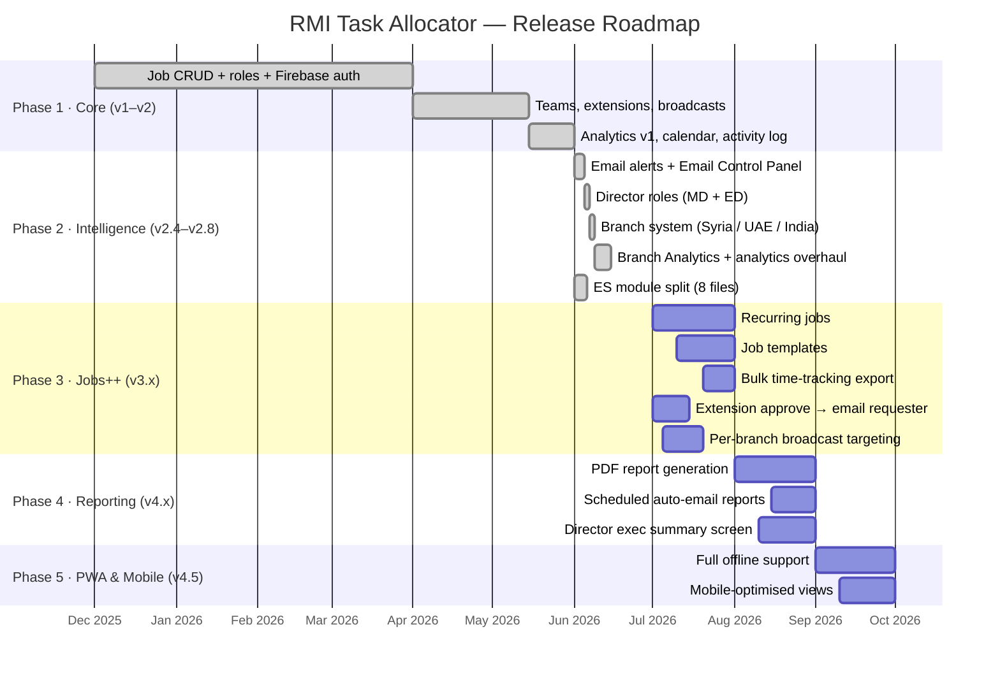

# RMI Task Allocator & Progress Tracker

> Internal job management platform for **Roof Metal Industries** — multi-branch, multi-role, real-time.  
> Managers assign and track jobs across teams in Syria, UAE, and India. Staff receive email alerts, comment on jobs, request deadline extensions, and monitor their own progress. Directors get a read-only live view across the entire organisation.

**Version:** v2.8.4 &nbsp;·&nbsp; **Hosted:** Cloudflare Pages &nbsp;·&nbsp; **Backend:** Firebase (Auth + Firestore + Storage) &nbsp;·&nbsp; **Stack:** Vanilla JS (ES modules) — no framework, no build step, no npm

---

## Table of Contents

1. [Features](#features)
2. [Role System](#role-system)
3. [Branch System](#branch-system)
4. [Module Architecture](#module-architecture)
5. [Data Model](#data-model)
6. [Email System](#email-system)
7. [Analytics](#analytics)
8. [Getting Started](#getting-started)
9. [Firebase Setup](#firebase-setup)
10. [Deploying to Cloudflare Pages](#deploying-to-cloudflare-pages)
11. [Running Locally](#running-locally)
12. [Troubleshooting](#troubleshooting)
13. [Roadmap](#roadmap)

---

## Features

| Category | What's included |
|----------|----------------|
| **Jobs** | Create, assign, start, pause, resume, complete, delete/restore, pin. Priority levels (High / Medium / Low). Job types as tags. Client + job number fields. |
| **Deadlines & Extensions** | Set deadlines on any job. Deadline banner appears 24 h before. Employees can request extensions; managers approve or reject. Extension rate tracked in analytics. |
| **Comments & Mentions** | Threaded comments on every job. `@mention` any user — they receive an in-app notification instantly. |
| **Attachments** | File uploads via Firebase Storage, shown inline on job cards. |
| **Teams** | Team Leaders manage their own group of Employees. Supervisors see all teams. Org chart visible to all staff roles. |
| **Broadcasts** | Managers send org-wide or role-targeted announcements. Appear as a notification for all recipients. |
| **In-app Notifications** | Real-time Firestore listener pushes notifications without refresh. Toast alerts for urgent events. |
| **Email Alerts** | EmailJS integration sends emails on assign, status change, deadline approach, overdue, extension. Manager-controlled via Email Control Panel. |
| **Email Control Panel** | Master on/off switch → per-event switches → per-recipient-type switches. Stored in Firestore `config/email`, shared across all manager accounts instantly. |
| **Analytics** | Role-specific dashboards: KPI strip, status donut, throughput, team health, overdue trend, branch breakdown, priority analysis, turnaround, leaderboard, and more. |
| **Branch Analytics** | Per-branch (Syria / UAE / India) breakdowns: active jobs, completed, overdue, on-time rate, avg turnaround. |
| **Calendar** | Monthly calendar view with jobs plotted by deadline. Filter by employee. |
| **Dashboard** | Summary cards, activity feed, deadline warning panel, status chart. Clickable panels navigate to filtered job lists. |
| **Search & Filter** | Search by client, job number, tag, assignee. Filter by status, priority, type, date range. CSV export. |
| **Dark / Light Mode** | System-preference aware. Toggle in Account settings. Persists across sessions. |
| **PWA** | Installable (Add to Home Screen). Service worker with network-first cache. Offline fallback. |
| **Activity Log** | Full audit trail: every status change, comment, assignment, reassignment, extension, and pause stored in Firestore `events`. |

---

## Role System

Six roles with strictly enforced scopes. All access is validated both client-side and in Firestore rules.

| Role | Badge | Can add/edit jobs | Sees all jobs | Team scope | Admin tools |
|------|-------|:-----------------:|:-------------:|-----------|-------------|
| `employee` | `EMP` | ✅ own submissions | ❌ own only | Assigned team | — |
| `team_leader` | `TL` | ✅ | ✅ team only | Manages a team | Assign within team |
| `supervisor` | `SUP` | ✅ | ✅ all | Cross-team | Assign anyone |
| `manager` | `MGR` | ✅ | ✅ all | All | Full: users, broadcasts, email control |
| `managing_director` | `MD` | ❌ read-only | ✅ all | All (view) | Read-only directory |
| `executive_director` | `ED` | ❌ read-only | ✅ all | All (view) | Read-only directory |

**Director rules:**
- Tabs available: Dashboard, Analytics, Teams (read-only), Jobs (read-only, renamed from "My Jobs"), Account, Users (read-only directory)
- Cannot add/edit/delete/assign/pause/start/resume any job
- Can view timeline and add comments on any job
- **Invisible to staff** — directors never appear in assignment dropdowns, team boards, or calendar employee filters

**Team Leader scope lock:**
- Always scoped to own team regardless of `viewAll` setting
- Cannot see or act on jobs outside their team

---

## Branch System

Each user account can be tagged with a branch: **RMI - Syria**, **RMI - UAE**, or **RMI - India**.

- Tag is set by a manager when creating or editing a user account
- Displayed as a coloured pill badge next to the role badge everywhere a user is shown
- Jobs roll up to their owner's branch automatically — no per-job branch field needed
- Branch filter in Analytics lets managers/supervisors/directors filter all widgets by branch
- Branch Analytics section shows side-by-side comparisons across all active branches

**Badge colours:**

| Branch | Colour |
|--------|--------|
| RMI - Syria | Amber |
| RMI - UAE | Teal |
| RMI - India | Coral |

---

## Module Architecture

Static ES modules — no bundler. Each file is a `<script type="module">`.

```
index.html
└── main.js          ← entry point, bootstraps Firebase listeners, renders all views
    ├── firebase.js  ← SDK re-exports + config constants (leaf, imports nothing app-side)
    ├── state.js     ← all shared mutable state as export let + setters + constants
    ├── helpers.js   ← pure utilities: time math, formatting, escaping (no side effects)
    ├── email.js     ← EmailJS wrappers + org-wide email gating layer
    ├── modals.js    ← Confirm/Complete/Extension/Reassign dialogs + tag chip inputs
    ├── jobs.js      ← Job CRUD, lifecycle actions, comments, extension approve/reject
    └── admin.js     ← Broadcasts + user management (add/edit/remove, renderUList)
```

**Circular import safety:**  
`modals`, `jobs`, and `admin` import functions back from `main.js`. These cycles are runtime-safe because every cross-module call happens **inside a function body** (after all modules finish evaluating), never at module-evaluation time. ES module live bindings ensure state changes propagate automatically.

**`window.*` surface:**  
HTML `onclick` attributes call global functions. These stay in the module that owns the feature — not re-exported as named imports — to avoid live-binding reassignment issues.

**State setters:**  
`state.js` exports `export let users` + `export function setUsers(v)`. Importers call `setUsers(...)` instead of direct assignment (which would throw — you cannot reassign an imported binding).

### File reference

| File | Lines | Responsibility |
|------|------:|---------------|
| `index.html` | ~900 | All markup: views, modals, login, sidebar |
| `styles.css` | ~1600 | Full design system — CSS vars, dark/light, all components |
| `main.js` | ~4000 | Auth, state bootstrap, render pipeline, analytics, calendar, dashboard, nav |
| `firebase.js` | 18 | Firebase SDK re-exports, MGR_PW, USE_FIREBASE flag |
| `state.js` | 70 | Shared state, setters, BRANCHES, EMAIL_EVENTS constants |
| `helpers.js` | 50 | toMillis, fmt, tdiff, escapeHtml, uid, timeAgo, job duration utils |
| `email.js` | 90 | emailJobOwner, emailManagers, org-wide gate (gMaster/gEvent/gRecip) |
| `modals.js` | 115 | showConfirm, complete modal, extension dialog, reassign dialog, tag chips |
| `jobs.js` | 290 | addJob, assignJob, startJob, pauseJob, doneJob, delJob, extAdd, extUpdate, comments |
| `admin.js` | 320 | addUser, removeUser, saveEditUser, renderUList, addBroadcast |
| `sw.js` | 34 | Network-first service worker, cache versioning |
| `manifest.webmanifest` | 30 | PWA metadata, icons, theme |
| `firestore.rules` | 60 | Security rules — all read/write access enforcement |

---

## Data Model

### Firestore Collections

| Collection | Description |
|-----------|-------------|
| `jobs` | All active jobs |
| `jobsArchive` | Soft-deleted jobs (restorable) |
| `users` | User profiles (role, email, branch, teamLeaderId, viewAll) |
| `usersByAuth` | Maps Firebase Auth UID → user profile ID (for login lookup) |
| `events` | Full activity log — every action on every job |
| `notifications` | In-app notifications per user |
| `extensions` | Deadline extension requests with status (pending/approved/rejected) |
| `broadcasts` | Org-wide and role-targeted announcements |
| `loginlogs` | Login timestamp records per user |
| `config` | Org-wide settings. `config/email` = Email Control state |

### Job Document Shape

```js
{
  id: string,           // auto-generated
  client: string,       // client/project name
  jobNum: string,       // job reference number
  type: string,         // job type tag
  priority: 'high' | 'medium' | 'low',
  status: 'pending' | 'ongoing' | 'paused' | 'completed',
  owner: string,        // user ID of assignee
  assignedBy: string,   // user ID of assigning manager
  created: timestamp,
  started: timestamp,
  completed: timestamp,
  deadline: timestamp,
  pinned: boolean,
  tags: string[],
  durationActiveMs: number,   // time spent working (pauses excluded)
  durationPausedMs: number,   // time spent paused
  attachments: string[],      // Firebase Storage URLs
}
```

### Job Status Flow

```
pending → ongoing → paused ⟲ ongoing → completed
                              ↑ resume
```

Deleted jobs move to `jobsArchive` (soft delete, restorable within the same session).

### Email Config Shape (`config/email`)

```js
{
  master: true,           // global on/off
  events: {
    assigned:   { on: true, owner: true, teamLeader: true, supervisor: true, manager: true },
    status:     { on: true, ... },
    deadline:   { on: true, ... },
    overdue:    { on: true, ... },
    extension:  { on: true, ... },
  }
}
```

---

## Email System

Powered by **EmailJS** (free tier). Triggered server-side by app events.

### Gating hierarchy

```
master switch
  └── per-event switch (assigned / status / deadline / overdue / extension)
        └── per-recipient-type switch (owner / teamLeader / supervisor / manager)
```

All three layers must be ON for an email to send. If master is OFF, nothing sends — regardless of lower switches.

### Email events

| Event | Trigger |
|-------|---------|
| `assigned` | Job assigned or reassigned to a user |
| `status` | Job status changes (start, pause, resume, complete) |
| `deadline` | Job deadline approaching (24 h warning) |
| `overdue` | Job passes its deadline without completion |
| `extension` | Extension request submitted, approved, or rejected |

### Email Control Panel

Accessible to managers only (sidebar → 📧 Email Control). Changes save to `config/email` in Firestore instantly — all manager accounts see the same state in real time via `onSnapshot`.

---

## Analytics

Role-aware analytics page. Content shown depends on viewer's role.

### KPI Strip (all roles)

Total Jobs · Completion Rate · Avg Completion Time · On-Time Rate

### Manager / Director analytics

| Section | Widgets |
|---------|---------|
| Overview | Status donut, Throughput by employee |
| Team | Team Member Health (overdue/active/completion%), Active vs Paused time |
| Trends | Overdue Rate Trend (line chart), Cross-Team Type Breakdown |
| Branch | Active / Completed / Overdue / On-Time Rate / Avg Turnaround per branch |
| Performance | Leaderboard grid (done/active/this week/overdue per person) |
| Job Analysis | Created vs Completed trend, Completion Rate by Priority, Priority vs Urgency, Extension Rate, Peak Workload Days, Job Age, Turnaround by Type, Most Reassigned Jobs |

### Supervisor analytics

Same as manager minus Performance Leaderboard. Plus Cross-Team widget and Branch Analytics.

### Team Leader analytics

Status donut · Throughput · Team Health · Active vs Paused · Overdue Trend · Leaderboard · Job Analysis

### Employee analytics

Status donut · My Jobs by Type · My Completion Trend · Speed vs Team Average · My Rank card · Job Analysis

### Filters

- **Date range:** Week / Month / Quarter / Year / All time
- **Employee** (managers/supervisors): filter all widgets to a specific person
- **Branch:** filter all widgets to Syria / UAE / India
- **Job type:** filter to specific job type tag

---

## Getting Started

### Prerequisites

- Firebase project with Firestore + Auth + Storage enabled
- EmailJS account (for email alerts — optional, app works without it)
- Cloudflare Pages account (or any static host)

### First-time setup checklist

- [ ] Clone repo
- [ ] Fill Firebase config in `firebase.js`
- [ ] Fill EmailJS credentials in `email.js` (service ID, template ID, public key)
- [ ] Publish `firestore.rules` to Firebase Console → Firestore → Rules
- [ ] Enable Email/Password auth provider in Firebase Console → Authentication → Sign-in method
- [ ] Add your Cloudflare Pages domain to Firebase → Authentication → Settings → Authorized domains
- [ ] Push to GitHub → Cloudflare Pages auto-deploys
- [ ] Open app → activate manager account (default temp password: `manager123`)
- [ ] Create your user accounts from the Users tab

---

## Firebase Setup

### 1. Firestore Rules

Paste contents of `firestore.rules` into **Firebase Console → Firestore Database → Rules → Publish**.

Rules enforce:
- Only authenticated users can read jobs/users/events
- Only managers can write to `users`, `config`, `broadcasts`
- Directors can read everything but write nothing
- Users can only write to their own `notifications`

### 2. Auth Provider

Firebase Console → Authentication → Sign-in method → **Email/Password → Enable**.

### 3. Authorized Domains

Firebase Console → Authentication → Settings → Authorized domains → **Add domain**.

Add:
- Your `*.pages.dev` URL
- Any custom domain (e.g. `app.roofmetal.net`)
- `localhost` (already there by default — for local dev)

### 4. Storage Rules

Allow authenticated users to read/write the `attachments/` path. Paste into Firebase Console → Storage → Rules:

```
rules_version = '2';
service firebase.storage {
  match /b/{bucket}/o {
    match /attachments/{allPaths=**} {
      allow read, write: if request.auth != null;
    }
  }
}
```

---

## Deploying to Cloudflare Pages

This is a fully static site — no build step.

### Connect GitHub (one-time)

1. [dash.cloudflare.com](https://dash.cloudflare.com) → **Pages → Create application → Connect to Git**
2. Authorize GitHub → select your repository
3. Branch: `main` · Build command: *(leave blank)* · Output directory: *(leave blank)*
4. **Save and Deploy**

From this point every `git push origin main` triggers an automatic deploy (~1 minute).

### Manual deploy (without GitHub)

Drag-and-drop your project folder into **Pages → Upload assets** in the Cloudflare dashboard. Not recommended — use GitHub integration instead.

### Cache busting on deploy

The service worker caches all files. **On every deploy**, the version string in `sw.js` line 2 is bumped automatically:

```js
const CACHE = 'rmi-v2.8.4'; // bumped each commit
```

This forces all clients to reload fresh files on next visit.

---

## Running Locally

Do **not** open via `file://` — ES modules and Firebase Auth both break on that protocol.

Use any local static server:

```bash
# Python (built-in)
python -m http.server 8000

# Node (if installed)
npx serve .

# VS Code
# Install "Live Server" extension → right-click index.html → Open with Live Server
```

Open `http://localhost:8000` — `localhost` is pre-authorized in Firebase Auth by default.

---

## Troubleshooting

| Symptom | Cause | Fix |
|---------|-------|-----|
| Blank page / nothing loads | Opened via `file://` | Use local server (`python -m http.server 8000`) |
| `auth/unauthorized-domain` | Cloudflare domain not in Firebase | Add Pages URL to Firebase Auth → Authorized domains |
| `permission-denied` on Firestore | Rules not published, or user has no `usersByAuth` mapping | Publish `firestore.rules`; ensure user completed account activation |
| Stale UI after deploy | Old service worker serving cached files | `CACHE` string in `sw.js` is bumped on every deploy — hard-refresh once (`Ctrl+Shift+R`) |
| Login fails: "No profile linked" | User in Firebase Auth but not in Firestore `users` collection | Create user profile from Users tab, then activate |
| Email not sending | EmailJS credentials wrong or master switch off | Check email.js credentials; check Email Control Panel master switch |
| Director sees Add Job button | Stale local state | Hard-refresh — director guard on `addJob()` always prevents actual submission |

---

## Roadmap



### Feature status

| Status | Feature |
|--------|---------|
| ✅ Shipped | Job CRUD · Role system (6 roles) · Firebase Auth · Firestore real-time sync · Teams + Team Leaders · Deadline extensions (request/approve/reject) · Comments + @mentions · File attachments · Broadcasts · In-app notifications · Email alerts (EmailJS) · Email Control Panel (cascading switches, Firestore-backed) · Analytics (role-specific, 20+ widgets) · Branch system (Syria/UAE/India) · Branch Analytics · Calendar · Dashboard · Search + filter + CSV export · Activity log · Dark/light mode · PWA + service worker · Auth guards on all destructive actions · ES module architecture (8 files) · Director read-only roles (MD + ED) · Grouped user directory with branch badges |
| 🔲 Planned | Recurring jobs · Job templates · Extension → email requester · Per-branch broadcast targeting · PDF reports · Scheduled auto-reports · Director exec summary · Full offline PWA · Mobile layout pass |
